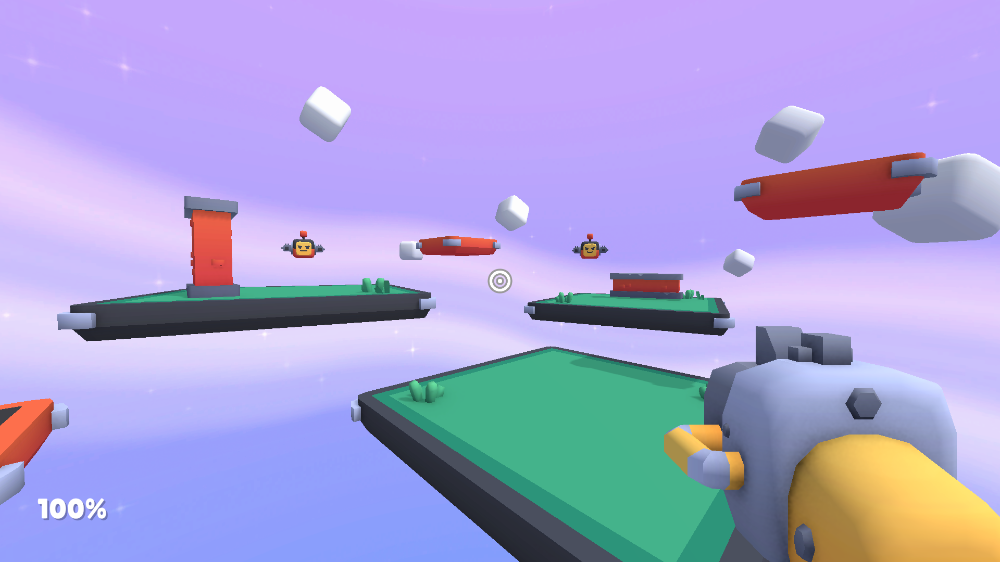

# Starter-Kit-FPS for Unity

> [!WARNING]
> This project is an unofficial **Unity port** of the original [Starter Kit FPS](https://github.com/KenneyNL/Starter-Kit-FPS) by [Kenney](https://kenney.nl). It is not affiliated with or endorsed by Kenney.

This repository includes a basic template for a first-person shooter game in Unity 6.6. Includes features like;

- Character controller (with double jump)
- Weapons (switching, knockback, spread), rendered by a dedicated overlay camera
- Weapon data as ScriptableObjects
- Enemies (flying, shooting)
- Gamepad support
- Sprites and 3D Models _(CC0 licensed)_
- Sound effects _(CC0 licensed)_

### Screenshot

### Controls

| Action        | Keyboard & Mouse     | Gamepad        |
|---------------|----------------------|----------------|
| Move          | WASD / Arrows        | Left stick     |
| Look          | Mouse                | Right stick    |
| Jump          | Space                | South button   |
| Shoot         | Left mouse button    | Right trigger  |
| Switch weapon | E / Middle mouse     | Right shoulder |
| Release mouse | Escape               |                |

### Instructions

1. How to add more weapons?

Each weapon is a `Weapon` ScriptableObject asset in the `Assets/Weapons` folder. Duplicate one of the existing assets (Ctrl+D / Cmd+D), or create a new one with *Create > Starter Kit FPS > Weapon*, then adjust its properties in the Inspector:

- **Model**: the 3D model (or prefab) shown in the player's hands.
- **Position / Rotation**: on-screen offset of the model.
- **Muzzle Position**: on-screen position of the muzzle flash.

Select the `Player` GameObject in the `Main` scene and add your new asset to the `Weapons` array. The first weapon in the array is equipped at start.

2. How to adjust properties like cooldown, damage and spread?

Select the weapon asset you'd like to change in the `Assets/Weapons` folder and adjust its properties (Cooldown, Damage, Spread, Shot Count, Knockback, sound and crosshair) in the Inspector. Changes apply to every player using that weapon.

### License

MIT License

Copyright (c) 2026 Frédéric Batardy

Permission is hereby granted, free of charge, to any person obtaining a copy of this software and associated documentation files (the "Software"), to deal in the Software without restriction, including without limitation the rights to use, copy, modify, merge, publish, distribute, sublicense, and/or sell copies of the Software, and to permit persons to whom the Software is furnished to do so, subject to the following conditions:

The above copyright notice and this permission notice shall be included in all copies or substantial portions of the Software.

THE SOFTWARE IS PROVIDED "AS IS", WITHOUT WARRANTY OF ANY KIND, EXPRESS OR IMPLIED, INCLUDING BUT NOT LIMITED TO THE WARRANTIES OF MERCHANTABILITY, FITNESS FOR A PARTICULAR PURPOSE AND NONINFRINGEMENT. IN NO EVENT SHALL THE AUTHORS OR COPYRIGHT HOLDERS BE LIABLE FOR ANY CLAIM, DAMAGES OR OTHER LIABILITY, WHETHER IN AN ACTION OF CONTRACT, TORT OR OTHERWISE, ARISING FROM, OUT OF OR IN CONNECTION WITH THE SOFTWARE OR THE USE OR OTHER DEALINGS IN THE SOFTWARE.

Assets included in this package (2D sprites, 3D models and sound effects) are [CC0 licensed](https://creativecommons.org/publicdomain/zero/1.0/)
